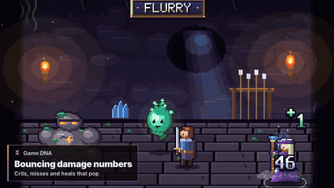
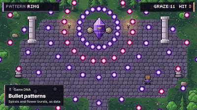
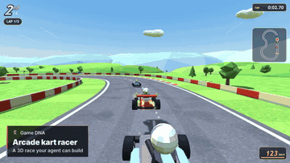
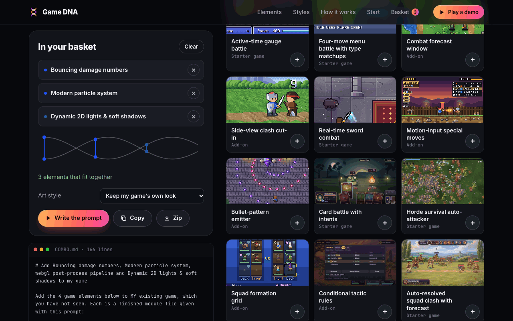
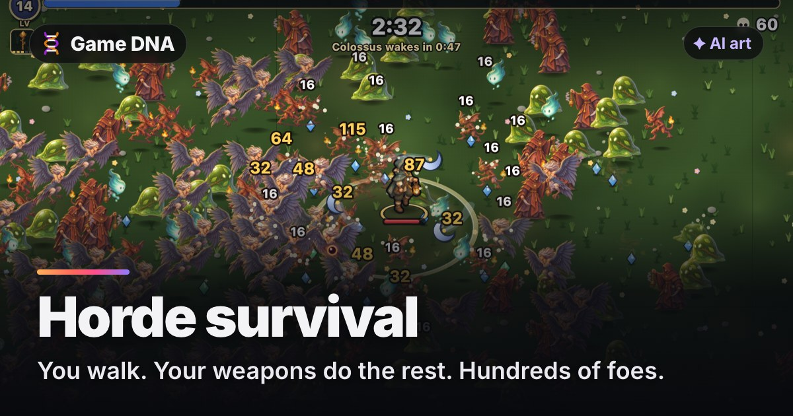
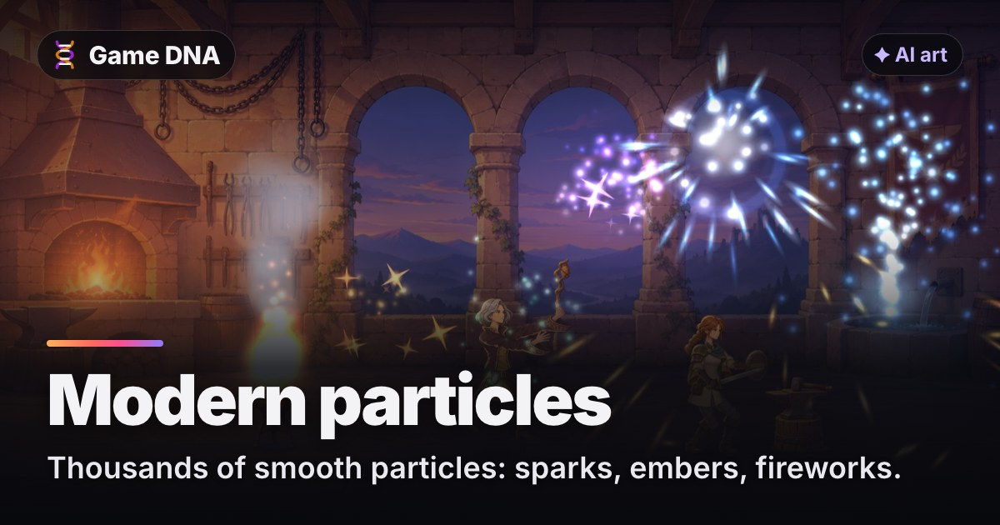
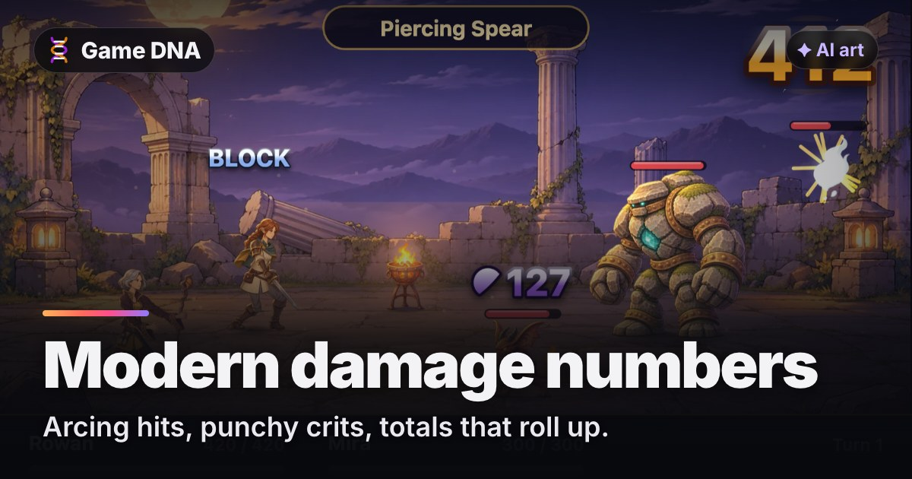
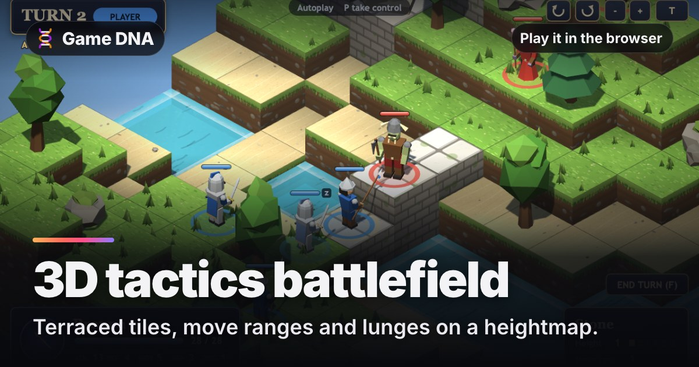
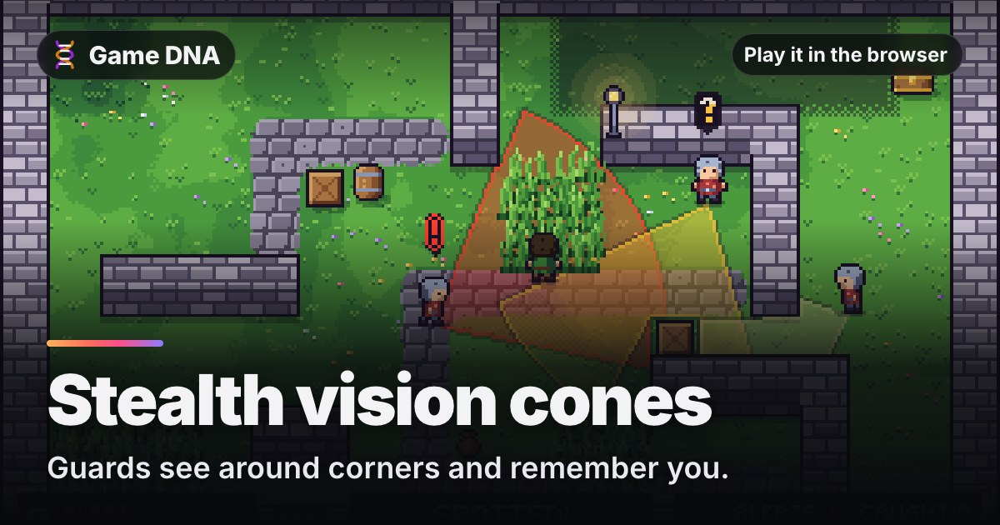
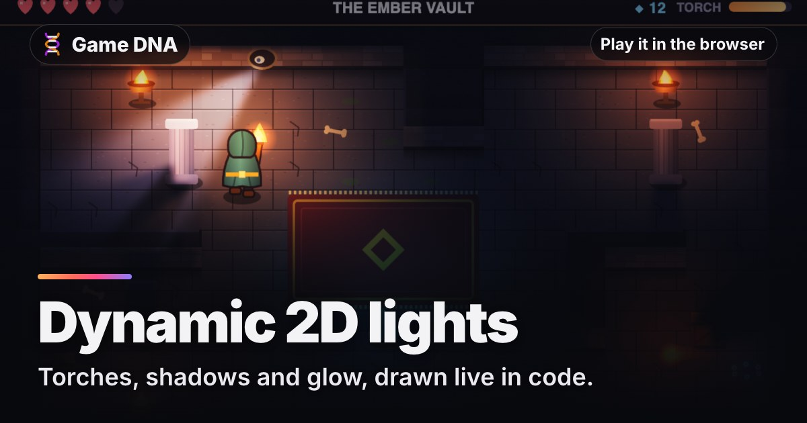

[English](README.md) | 繁體中文

# Game DNA

**給 coding agent 用的 100+ 個遊戲元素。挑一個，拿出你的網頁遊戲，agent 就會把它接進你的程式碼，從傷害數字到動態光源都有。**

### ▶ [打開展示館](https://game-dna.pages.dev)

[](LICENSE) [](https://game-dna.pages.dev/site/preview/) [](https://game-dna.pages.dev/site/preview/tests/) [](https://game-dna.pages.dev/site/preview/)

<p align="center">
<a href="https://game-dna.pages.dev/site/preview/#video"></a>
</p>

<p align="center">
<a href="https://game-dna.pages.dev/site/preview/dna/damage-numbers/"></a>
<a href="https://game-dna.pages.dev/site/preview/dna/bullet-patterns/"></a>
<a href="https://game-dna.pages.dev/site/preview/dna/kart-racer-3d/"></a>
</p>

## 怎麼用

1. 在[展示館](https://game-dna.pages.dev)**挑一個元素**。
2. **玩它的示範**，看它會替遊戲加上什麼。
3. 在你的遊戲資料夾裡，**對 agent 說一句話**：

```text
Add Game DNA's damage-pop element to my game: follow https://github.com/lucemia/game-dna/blob/main/elements/damage-pop/prompt.md and use the module in https://github.com/lucemia/game-dna/tree/main/elements/damage-pop/module.
```

中文也可以：

```text
把 Game DNA 的 damage-pop 元素加進我的遊戲：照 https://github.com/lucemia/game-dna/blob/main/elements/damage-pop/prompt.md 做，並使用 https://github.com/lucemia/game-dna/tree/main/elements/damage-pop/module 裡的模組。
```

延伸閱讀（英文）：[怎麼做、怎麼測](https://game-dna.pages.dev/site/preview/blog/how-game-dna-works/) · [5 分鐘上手](https://game-dna.pages.dev/site/preview/start/) · [一步一步來](#交給你的-agent)

## 為什麼

請 coding agent「加上傷害數字」，它會加。然後數字蓋住 HUD、王戰打不下去，或是舊的存檔畫面悄悄壞掉。只給一句話，
讓一個功能「感覺對」的那些細節，agent 只能全部用猜的。

Game DNA 給 agent 三樣東西，取代猜測：

- **一個模組**：小型、沒有相依套件的 JavaScript 檔，負責實際的工作（MIT）；
- **一份 prompt**（最多 600 字）：說明要接在*你的*遊戲哪裡、哪些不能動、常見的錯誤；
- **一套檢查方式**：不用瀏覽器就能跑的自我檢查，加上肉眼看得到的驗收檢查。

每個元素都有可以玩的示範。大部分是外掛，可以放進任何遊戲（手感、特效、介面、音效、光影）；
其餘是系統（戰鬥、地圖流程、賽車），附一個起手遊戲，讓 agent 在上面擴充。
所有美術都是原創，大部分直接用程式畫。

## 組合籃：一次用好幾個元素

網站上的[組合籃](https://game-dna.pages.dev/site/preview/basket/)可以挑好幾個元素，檢查它們能不能一起用，再產出一份合併的 prompt 和一個模組 zip
給你的 agent。

<a href="https://game-dna.pages.dev/site/preview/basket/"></a>

## 元素目錄

全部元素，依類別分組。元素名稱和說明維持英文。點 **試玩** 會打開該元素的頁面，有即時示範和 prompt。✦ = 示範用了 AI 生成的美術。

<a href="https://game-dna.pages.dev/site/preview/dna/horde-survival/"></a>

<details><summary><b>戰鬥系統</b> Battle systems（15）</summary>

| 元素 | 做什麼（英文） | 示範 |
|---|---|---|
| **Active-time gauge battle** | Every combatant's gauge fills in real time at a speed-based rate; a full hero gauge opens that hero's command window. *（起手遊戲）* | [試玩](https://game-dna.pages.dev/site/preview/dna/active-time-battle/) |
| **Auto-resolved squad clash with forecast** ✦ | Two squads on 2x3 grids (front row takes melee, back row is shielded from it while the front stands) meet; before committing. *（起手遊戲）* | [試玩](https://game-dna.pages.dev/site/preview/dna/squad-clash/) |
| **Bullet-pattern emitter** | Enemies cast bullet patterns described as data: fans and aimed bursts, rings, spirals, flowers whose speed dips between petals, weaving waves. | [試玩](https://game-dna.pages.dev/site/preview/dna/bullet-patterns/) |
| **Card battle with intents** ✦ | A turn-based card battle: draw a fanned hand each turn, drag a card onto a foe (a target arrow follows; keys and taps work too) and pay its cost from a small… *（起手遊戲）* | [試玩](https://game-dna.pages.dev/site/preview/dna/card-battle/) |
| **Combat forecast window** | Before an attack is confirmed, a two-sided window shows what will happen: both units' HP now and after, damage, hit and critical chances. | [試玩](https://game-dna.pages.dev/site/preview/dna/combat-forecast/) |
| **Conditional tactic rules** ✦ | Every unit decides with an ordered list of rules, "condition → action (target)": ally HP under a threshold, a flying or armoured foe, a back-row target. | [試玩](https://game-dna.pages.dev/site/preview/dna/tactic-rules/) |
| **Four-move menu battle with type matchups** | Turn-based creature battle, one on one (or two on two): each creature has up to four moves with uses left and a type; a type chart doubles. *（起手遊戲）* | [試玩](https://game-dna.pages.dev/site/preview/dna/four-move-battle/) |
| **Horde survival auto-attacker** ✦ | The hero only walks (keys, WASD or a touch stick); weapons fire by themselves on timers: orbiting blades, a bolt at the nearest foe. *（起手遊戲）* | [試玩](https://game-dna.pages.dev/site/preview/dna/horde-survival/) |
| **Match-3 battle board** ✦ | A puzzle battle on an 8 x 8 gem board: swap two neighbours to line up 3 or more; matches clear, gems fall and cascades chain (each step worth more). *（起手遊戲）* | [試玩](https://game-dna.pages.dev/site/preview/dna/match3-battle/) |
| **Motion-input special moves** | Reads the stick and buttons once per fixed step into a short input buffer and recognises special-move motions written relative to the way the hero faces. | [試玩](https://game-dna.pages.dev/site/preview/dna/motion-inputs/) |
| **On-map skirmish exchange** | The attack exchange plays on the map itself instead of cutting to a side-view scene (the alternative to Side-view clash cut-in clash-cutin). | [試玩](https://game-dna.pages.dev/site/preview/dna/on-map-skirmish/) |
| **Real-time sword combat** | Top-down real-time melee on the map: a 4- or 8-way sword swing with anticipation, active and recovery frames and a sweeping arc hitbox. *（起手遊戲）* | [試玩](https://game-dna.pages.dev/site/preview/dna/sword-combat/) |
| **Side-view clash cut-in** | When a turn or tactics battle confirms an attack, the game cuts to a staged side-view scene. | [試玩](https://game-dna.pages.dev/site/preview/dna/clash-cutin/) |
| **Squad formation grid** | Each side fights as squads on a 2x3 grid: a front row that faces the enemy and a back row behind it. | [試玩](https://game-dna.pages.dev/site/preview/dna/squad-formation/) |
| **Tower placement & wave spawner** | A tower-defense core: foes march along a fixed road through a grid (one or more paths from waypoint cells); towers go on the grass cells beside it. *（起手遊戲）* | [試玩](https://game-dna.pages.dev/site/preview/dna/tower-defense/) |

</details>

<a href="https://game-dna.pages.dev/site/preview/dna/modern-particles/"></a>

<details><summary><b>特效與手感</b> Effects &amp; feel（15）</summary>

| 元素 | 做什麼（英文） | 示範 |
|---|---|---|
| **Bouncing damage numbers** | On the frame a hit lands, the amount pops above the target, each digit bouncing in turn with a small overshoot, holds, then fades; heals, criticals, misses. | [試玩](https://game-dna.pages.dev/site/preview/dna/damage-numbers/) |
| **Dissolve-out defeat** | A defeated unit blinks white and dissolves from a snapshot of its sprite (dither-noise fade, horizontal slice wipe, pixel crumble with gravity,… | [試玩](https://game-dna.pages.dev/site/preview/dna/dissolve-defeat/) |
| **Hit sparks & spell bursts** | On the frame a blow lands, a few frames of impact at the contact point (slash streak, star burst, cross spark or ring shockwave) with pooled pixel sparks… | [試玩](https://game-dna.pages.dev/site/preview/dna/hit-sparks/) |
| **Hit-stop, shake & flash** | On a hit the world freezes for a few frames (hit-stop), the play field shakes by whole pixels and decays, and the struck sprite turns white for a frame or two. | [試玩](https://game-dna.pages.dev/site/preview/dna/hit-stop-shake/) |
| **Loot drops with rarity beams** ✦ | Defeated foes and opened chests pop loot that arcs out with a ground shadow, lands with a bounce on free ground (landing spot and whole flight path tested… | [試玩](https://game-dna.pages.dev/site/preview/dna/loot-beams/) |
| **Modern particle system** ✦ | One pooled, seeded engine for thousands of smooth particles: emitter shapes (point, line, circle, rect, sprite outline). | [試玩](https://game-dna.pages.dev/site/preview/dna/modern-particles/) |
| **Physics debris & breakables** ✦ | Breakable props, either the game's own art (painted or pixel) or built-in crates, barrels, pots, statues and crystals. | [試玩](https://game-dna.pages.dev/site/preview/dna/physics-debris/) |
| **Procedural IK creatures** | The game's ground-walking foes become many-legged creatures (spider, crab, centipede) whose feet plant on the game's own ground with 2-bone IK and step when… | [試玩](https://game-dna.pages.dev/site/preview/dna/ik-creatures/) |
| **Ribbon trails** ✦ | Smooth tapered ribbons behind anything fast: a sword swing leaves a swept crescent from hilt to tip, a dash or lunge a soft body-wide ribbon. | [試玩](https://game-dna.pages.dev/site/preview/dna/ribbon-trails/) |
| **Shatter battle transition** | When a battle starts, the current frame is captured, cracks from the point of contact and breaks into shards that spin and fall (or swirls, pixelates… | [試玩](https://game-dna.pages.dev/site/preview/dna/battle-transition/) |
| **Spring water surface and splashes** ✦ | Pits, ponds and lakes of a side-view game get a surface made of springs: anything that falls in throws a crown of droplets and a curved splash sheet… | [試玩](https://game-dna.pages.dev/site/preview/dna/water-surface/) |
| **Squash, stretch & anticipation** | Every sprite the game already draws gets procedural squash and stretch about its feet, with no new frames: a crouch before jumps, swings and spells. | [試玩](https://game-dna.pages.dev/site/preview/dna/squash-stretch/) |
| **Time rewind** ✦ | Hold a key (or the touch button) and the world runs backwards: every fixed step the game's state is deep-copied into a ring buffer. | [試玩](https://game-dna.pages.dev/site/preview/dna/time-rewind/) |
| **Verlet rope & cloth** ✦ | Capes, scarves, ribbons, hair tufts, banners, hanging ropes and chains that swing with movement and wind. | [試玩](https://game-dna.pages.dev/site/preview/dna/verlet-cloth/) |
| **Weather & ambient particles** | Seeded weather drawn in three depth layers behind and in front of the sprites: rain that splashes on the game's own ground line, snow, drifting dust motes. | [試玩](https://game-dna.pages.dev/site/preview/dna/weather-particles/) |

</details>

<details><summary><b>生成美術</b> Generated art（12）</summary>

| 元素 | 做什麼（英文） | 示範 |
|---|---|---|
| **Art-direction lock** ✦ | Generate one style-reference sheet for the game (a character, a prop, a floor patch and an item), lock it. | [試玩](https://game-dna.pages.dev/site/preview/dna/art-direction-lock/) |
| **Card illustrations** ✦ | Painted 2:3 card illustrations generated once and locked to one style (light from the top-left, the subject in the upper safe area, a calm darker lower half… | [試玩](https://game-dna.pages.dev/site/preview/dna/card-art/) |
| **Expressive portraits** | Hand-made-looking 16-bit bust portraits built from a small seeded spec (head, skin, eyes, brows, mouth, hair style and colour, ears, hood / helmet / circlet… | [試玩](https://game-dna.pages.dev/site/preview/dna/expressive-portraits/) |
| **Layered cutout characters** ✦ | HD painted characters built from cut-out parts and moved by a small bone rig in code instead of frame-by-frame drawing. | [試玩](https://game-dna.pages.dev/site/preview/dna/cutout-characters/) |
| **Material & normal maps** ✦ | A script turns every generated bitmap with alpha into a height map (alpha distance field rounded into a dome, plus the painting's own local light and dark as… | [試玩](https://game-dna.pages.dev/site/preview/dna/normal-maps/) |
| **NPC generator** | Seeded townsfolk built from parts (age, body type, skin, hair style and colour, clothes, hats, glasses or beards, satchels and scarves). | [試玩](https://game-dna.pages.dev/site/preview/dna/npc-generator/) |
| **Painted parallax layers** ✦ | The flat background of a side-view HD game becomes 3-5 hand-painted layers (far sky and ridges, drifting clouds, mid hills, near silhouettes, and an opaque… | [試玩](https://game-dna.pages.dev/site/preview/dna/painted-parallax/) |
| **Palette-swap variants** | One sprite, many looks without new art: the module finds the sprite's colour ramps (clothing, body, skin, steel, outline) and maps them dark-to-light onto… | [試玩](https://game-dna.pages.dev/site/preview/dna/palette-swap/) |
| **Paper doll** | A layered pixel hero (body, hair, hat, top, legs, boots, weapon, shield) with swappable parts and palette tints. | [試玩](https://game-dna.pages.dev/site/preview/dna/paper-doll/) |
| **Portrait set with expressions** ✦ | Painted bust portraits for dialogue, generated once: a neutral base per character and each expression made as an edit of that base with the base as… | [試玩](https://game-dna.pages.dev/site/preview/dna/painted-portraits/) |
| **Talking portraits** | Portraits animated by the dialogue: a typewriter that owns the line (or follows the game's own). | [試玩](https://game-dna.pages.dev/site/preview/dna/talking-portraits/) |
| **UI frames & icon sheet** ✦ | A generated, style-locked UI kit (nine-slice window and small frames, a selection frame, an item slot, a pointer and a 24-icon sheet). | [試玩](https://game-dna.pages.dev/site/preview/dna/painted-ui/) |

</details>

<a href="https://game-dna.pages.dev/site/preview/dna/damage-pop/"></a>

<details><summary><b>介面與文字</b> UI &amp; text（12）</summary>

| 元素 | 做什麼（英文） | 示範 |
|---|---|---|
| **Bevelled window + pointer cursor** | A drop-in replacement for plain text boxes and menus: bevelled gradient windows that grow from their centre when they open. | [試玩](https://game-dna.pages.dev/site/preview/dna/window-cursor/) |
| **Big banner text** | Phase, wave and result moments ('PLAYER PHASE', 'WAVE 2', 'STAGE CLEAR', 'VICTORY') get large chunky shaded letters that slide in over a translucent… | [試玩](https://game-dna.pages.dev/site/preview/dna/big-banner/) |
| **Draining HP bar** ✦ | A hit drops the fill at once while a pale loss segment holds where the health was, then drains down; quick hits extend the hold and merge into one segment. | [試玩](https://game-dna.pages.dev/site/preview/dna/draining-hp-bar/) |
| **Keyword tooltips** ✦ | Rich text whose keywords (statuses, stats, terrain, rules) open a tooltip on mouse hover, touch long-press or tap and keyboard focus: icon, title. | [試玩](https://game-dna.pages.dev/site/preview/dna/keyword-tooltips/) |
| **Minimap** | A corner map of the level that the player fills in by exploring: the tile grid (or collision boxes) baked once into a cached image per zoom. | [試玩](https://game-dna.pages.dev/site/preview/dna/minimap/) |
| **Modern damage numbers** ✦ | 2020s damage numbers: each hit arcs out of the target and lands, crits pop with a big overshoot, a burst and a short shake. | [試玩](https://game-dna.pages.dev/site/preview/dna/damage-pop/) |
| **Pixel bitmap font** | Every letter on a low-res canvas drawn from an original 1-bit bitmap font at whole pixels, so text is as crisp as the sprites at any scale. | [試玩](https://game-dna.pages.dev/site/preview/dna/pixel-font/) |
| **Springy UI motion** ✦ | Motion design for the windows and menus a game already draws: panels open with an elastic pop, slide or unfold and close faster than they open. | [試玩](https://game-dna.pages.dev/site/preview/dna/springy-ui/) |
| **Title screen & menu flow** | A title screen built on the game's own art (its name as a bold pixel logo with a glint, a tagline, PRESS START), a menu (continue, new game, options, quit). | [試玩](https://game-dna.pages.dev/site/preview/dna/title-menu/) |
| **Toasts & unlock pop-ups** ✦ | Achievement, quest-update and item-get notices slide in from a screen edge, stack and glide, leave on a visible timer line. | [試玩](https://game-dna.pages.dev/site/preview/dna/toasts/) |
| **Turn-order bar** | A strip of small portraits showing who acts next: the current actor sits first in a gold frame and bounces, the next 6-10 units follow in team-coloured frames. | [試玩](https://game-dna.pages.dev/site/preview/dna/turn-order-bar/) |
| **World-space HUD** | HUD pieces that live in the world and follow the camera: a ring under every unit's feet with an HP arc whose pale loss segment drains after a hit. | [試玩](https://game-dna.pages.dev/site/preview/dna/world-hud/) |

</details>

<a href="https://game-dna.pages.dev/site/preview/dna/tactics-grid-3d/"></a>

<details><summary><b>3D 與 2.5D</b> 3D &amp; 2.5D（10）</summary>

| 元素 | 做什麼（英文） | 示範 |
|---|---|---|
| **3D tactics battlefield on a heightmap grid** | A small three.js battlefield of terraced tiles (grass, stone, sand, water) with trees, rocks and ruins. *（起手遊戲）* | [試玩](https://game-dna.pages.dev/site/preview/dna/tactics-grid-3d/) |
| **Arcade kart racer (3D)** | A low-poly 3D kart race: a track built from a closed spline (road, kerbs, barriers, ramps, boost pads, start gantry with countdown lamps). *（起手遊戲）* | [試玩](https://game-dna.pages.dev/site/preview/dna/kart-racer-3d/) |
| **Belt depth (beat-'em-up lanes)** | Gives every character in a side-view game a depth z on a walkable floor band, as in classic street brawlers. | [試玩](https://game-dna.pages.dev/site/preview/dna/belt-depth/) |
| **Camera director** ✦ | Replaces a hard-follow camera with a directed one: a critically damped spring with a dead zone, eased look-ahead in the facing or moving direction. | [試玩](https://game-dna.pages.dev/site/preview/dna/camera-director/) |
| **Painted billboard sprites in a 3D diorama** ✦ | Painted 2D characters stand in a three.js world as camera-facing billboards: yaw-only quads with their feet on the floor or tile top. | [試玩](https://game-dna.pages.dev/site/preview/dna/billboard-sprites-3d/) |
| **Raycast dungeon** | A first-person grid dungeon crawler drawn by raycasting: one DDA ray per screen column with the perpendicular distance (no fisheye, no gaps). *（起手遊戲）* | [試玩](https://game-dna.pages.dev/site/preview/dna/raycast-dungeon/) |
| **Sprite stacking (pseudo-3D props from pixel slices)** | Turns props (crates, barrels, trees, rocks, houses, wells, stalls, carts, a vehicle, lamps, fences) into pseudo-3D objects made of stacked pixel slices. | [試玩](https://game-dna.pages.dev/site/preview/dna/sprite-stacking/) |
| **Third-person 3D character and camera** | A low-poly adventurer on a small 3D island seen from a smooth follow camera: camera-relative movement (keys or touch stick). *（起手遊戲）* | [試玩](https://game-dna.pages.dev/site/preview/dna/third-person-3d/) |
| **Toon outlines and cel shading for a three.js scene** | One call turns an existing three.js scene cel-shaded: every lit material becomes a toon copy with 2-4 light bands, a cool shadow tint. | [試玩](https://game-dna.pages.dev/site/preview/dna/toon-outlines-3d/) |
| **Wave-collapse town builder (3D)** | A cosy three.js town builder on a grid: click a cell to raise it (sea, land, a house, more storeys) and wave function collapse resolves every wall, door. *（起手遊戲）* | [試玩](https://game-dna.pages.dev/site/preview/dna/wfc-town-3d/) |

</details>

<a href="https://game-dna.pages.dev/site/preview/dna/vision-cones/"></a>

<details><summary><b>地圖與移動</b> Maps &amp; movement（10）</summary>

| 元素 | 做什麼（英文） | 示範 |
|---|---|---|
| **Enemy threat range** | One key or button paints every tile any enemy could move to or strike this turn as a red tinted zone with a crisp marching outline. | [試玩](https://game-dna.pages.dev/site/preview/dna/threat-range/) |
| **Fog of war** | On a tile map, everything outside your units' sight sinks under a slowly drifting, dithered fog with a soft one-tile edge; terrain stays faintly readable. | [試玩](https://game-dna.pages.dev/site/preview/dna/fog-of-war/) |
| **Grappling hook & swing** | Fire a hook at iron rings (aim assist) or any rock surface, hang on a rope of fixed length and swing like a pendulum, pump with left / right, reel in and out. | [試玩](https://game-dna.pages.dev/site/preview/dna/grapple-swing/) |
| **Grid movement range + path arrow** | Select a unit on a tile map to see every tile it can reach (blue, terrain-cost aware) and every tile it can strike (red). *（起手遊戲）* | [試玩](https://game-dna.pages.dev/site/preview/dna/grid-range-path/) |
| **Isometric height & jump** | A 2:1 isometric tactics map where every tile has a height: units climb at most their jump, shoot farther from high ground, hit harder from above or behind. *（起手遊戲）* | [試玩](https://game-dna.pages.dev/site/preview/dna/iso-height-map/) |
| **Level-select path reveal** | An overworld map between levels: level, secret, castle, save-hut, shop and bonus nodes joined by paths; the hero walks node to node along the paths. *（起手遊戲）* | [試玩](https://game-dna.pages.dev/site/preview/dna/level-select-map/) |
| **Platformer movement feel** | Side-view hero movement and tile collision that feels good: acceleration curves on the ground and in the air, variable jump height, coyote time. *（起手遊戲）* | [試玩](https://game-dna.pages.dev/site/preview/dna/platformer-feel/) |
| **Procedural dungeon floors** | A turn-based dungeon crawl on seeded floors: rooms placed at random, joined by a minimum spanning tree of corridors plus a few loops, doors and arches. *（起手遊戲）* | [試玩](https://game-dna.pages.dev/site/preview/dna/dungeon-floors/) |
| **Pseudo-3D flight ground** | Call a mount on the top-down map and the ground zooms, turns and tilts into a perspective, scanline-scaled plane with a horizon sky band. *（起手遊戲）* | [試玩](https://game-dna.pages.dev/site/preview/dna/pseudo3d-flight/) |
| **Stealth vision cones** | Guards see through view cones clipped by walls (a ray-cast visibility polygon, the same rays that decide who is seen). | [試玩](https://game-dna.pages.dev/site/preview/dna/vision-cones/) |

</details>

<details><summary><b>經濟與成長</b> Economy &amp; growth（8）</summary>

| 元素 | 做什麼（英文） | 示範 |
|---|---|---|
| **Branching run map** ✦ | The roguelite route between fights: a seeded map of floors whose battle, elite, event, shop and rest nodes are joined by paths that never cross. | [試玩](https://game-dna.pages.dev/site/preview/dna/run-map/) |
| **Crafting recipes** ✦ | A recipe book with discovery and a slot bench over the game's own inventory: learned recipes in colour (a green dot when craftable now, a sparkle when new). | [試玩](https://game-dna.pages.dev/site/preview/dna/crafting-recipes/) |
| **Farming plots** | A farm loop on a tile grid: till, plant, water, crops grow one stage-step per watered night with every stage drawn, harvest once. *（起手遊戲）* | [試玩](https://game-dna.pages.dev/site/preview/dna/farming-plots/) |
| **Level-up stat growth** | Experience and levels for a party: after a fight a results window counts EXP and gold up, each unit's gauge fills and wraps with LV UP! | [試玩](https://game-dna.pages.dev/site/preview/dna/level-up-growth/) |
| **Shaped inventory packing** ✦ | A grid bag where every item takes its real shape (1x1 potions, 1x3 staves, a 5-cell axe, L, T, S and plus pieces). | [試玩](https://game-dna.pages.dev/site/preview/dna/shaped-inventory/) |
| **Shop & inventory grid** | A modal shop window: buy and sell lists with icons, prices and an amount picker, a bag grid with stacks, a max stack and a capacity, tooltips. | [試玩](https://game-dna.pages.dev/site/preview/dna/shop-inventory/) |
| **Stamina & outpost rest** | Squads (or a hero) spend stamina on every march and every attack; at zero they are exhausted. | [試玩](https://game-dna.pages.dev/site/preview/dna/stamina-rest/) |
| **Upgrade draft (pick 1 of 3)** ✦ | The roguelite level-up choice: at a moment the game chooses (level-up, chest, wave clear) the world pauses and three upgrade cards deal in with a fan. | [試玩](https://game-dna.pages.dev/site/preview/dna/upgrade-draft/) |

</details>

<details><summary><b>基礎</b> Foundations（6）</summary>

| 元素 | 做什麼（英文） | 示範 |
|---|---|---|
| **Multi-layer parallax backdrop** | A flat single background becomes 3-6 generated, original pixel-art layers (dithered sky, clouds or a cave ceiling, far range, back range, a tree / cliff /… | [試玩](https://game-dna.pages.dev/site/preview/dna/parallax-layers/) |
| **Native resolution + integer scaling** | A game that stretches its small canvas with CSS (blurry, uneven pixels) becomes pixel-perfect: the canvas keeps drawing at its native size. | [試玩](https://game-dna.pages.dev/site/preview/dna/pixel-scaler/) |
| **Save & load slots** | A save/load screen with three slots (plus an autosave slot): each shows a tiny thumbnail point-sampled from the game's own screen at native resolution. | [試玩](https://game-dna.pages.dev/site/preview/dna/save-slots/) |
| **Seeded replay & ghost** | Records every run as its seed plus the player's raw input on each fixed step, and plays it back through the game's own step function to the identical end… | [試玩](https://game-dna.pages.dev/site/preview/dna/seeded-replay/) |
| **Touch controls with edge-latched input** | A pixel-style D-pad or virtual stick with A/B buttons and a START pill appears on phones, below the game canvas. | [試玩](https://game-dna.pages.dev/site/preview/dna/touch-controls/) |
| **WebGL post-process pipeline** | The game keeps drawing on its own 2D canvas; each frame that canvas becomes a texture on a WebGL layer laid exactly over it. | [試玩](https://game-dna.pages.dev/site/preview/dna/webgl-post/) |

</details>

<details><summary><b>音效與節奏</b> Audio &amp; rhythm（5）</summary>

| 元素 | 做什麼（英文） | 示範 |
|---|---|---|
| **Adaptive music** | Layered music that follows the game's state over chip music: each chip channel is a stem (bass, drums, melody, a tense danger line), drums come in for fights. | [試玩](https://game-dna.pages.dev/site/preview/dna/adaptive-music/) |
| **Beat judge** | A beat clock and an input reviewer for rhythm actions: every press the game accepts is rated Perfect, Good or Miss against the nearest beat. | [試玩](https://game-dna.pages.dev/site/preview/dna/beat-judge/) |
| **Chip music** | A four-channel chip band synthesized in Web Audio from pattern data: two pulse leads with duty cycle, a stepped triangle bass and a noise drum kit. | [試玩](https://game-dna.pages.dev/site/preview/dna/chip-music/) |
| **Procedural sound effects** | Fourteen game sounds (hit, crit, coin, jump, land, footstep, menu move / confirm / cancel, explosion, laser, power-up, heal, hurt) synthesized live with Web… | [試玩](https://game-dna.pages.dev/site/preview/dna/procedural-sfx/) |
| **Timing-bar minigame** | Any 'skill check' moment (picking a lock, a timed attack bonus, forging, reeling in a fish) opens a small window with a bar. | [試玩](https://game-dna.pages.dev/site/preview/dna/timing-bar/) |

</details>

<details><summary><b>對話與劇情</b> Dialogue &amp; story（5）</summary>

| 元素 | 做什麼（英文） | 示範 |
|---|---|---|
| **Branching choices with flags** | After a line of dialogue, a small window of 2 to 4 options opens beside the text box: arrows move a hand cursor, Z / tap picks. | [試玩](https://game-dna.pages.dev/site/preview/dna/dialogue-choices/) |
| **Quest log & objectives** | Quests as data with ordered steps and counters: the game only reports what happened (kill, collect, talk, reach) and the module advances the right step. | [試玩](https://game-dna.pages.dev/site/preview/dna/quest-log/) |
| **Scripted cutscenes** | A small script plays a scene in the game's own world: characters walk to points with real walk frames that advance with the distance they cover and always… | [試玩](https://game-dna.pages.dev/site/preview/dna/scripted-cutscenes/) |
| **Typewriter dialogue box** | Story text in a framed box at the bottom (or top) of the screen: each line types out letter by letter with small pauses at punctuation. | [試玩](https://game-dna.pages.dev/site/preview/dna/dialogue-box/) |
| **World-space bark bubbles** ✦ | Short lines in speech bubbles above characters, in the world, while the game keeps running: guards shout "Halt!" in a yellow alarm bubble when they spot you. | [試玩](https://game-dna.pages.dev/site/preview/dna/bark-bubbles/) |

</details>

<a href="https://game-dna.pages.dev/site/preview/dna/dynamic-lights/"></a>

<details><summary><b>光影與後製</b> Light &amp; post-processing（5）</summary>

| 元素 | 做什麼（英文） | 示範 |
|---|---|---|
| **Bloom & glow** ✦ | Bright areas bleed soft light: a soft-knee threshold (0..1) picks the bright pixels. | [試玩](https://game-dna.pages.dev/site/preview/dna/bloom-glow/) |
| **Colour grading LUT** ✦ | The whole picture is graded through a 32x32x32 colour lookup table (a 1024x32 strip texture) on the WebGL post-process pipeline WebGL post layer. | [試玩](https://game-dna.pages.dev/site/preview/dna/color-grade-lut/) |
| **Dynamic 2D lights & soft shadows** | Point lights and spotlights with soft falloff, colour and deterministic flicker; lights that ride on actors (a torch on the hero, glowing projectiles)… | [試玩](https://game-dna.pages.dev/site/preview/dna/dynamic-lights/) |
| **Normal-mapped sprite lighting** ✦ | Sprites catch the light: every sprite drawn through the module writes its normals (from an Material & normal maps normal map, or derived from the drawn… | [試玩](https://game-dna.pages.dev/site/preview/dna/normal-lighting/) |
| **Screen-space distortion** ✦ | The finished picture bends like hot air, water and lenses: heat haze rising over fires, a slow wobble under water. | [試玩](https://game-dna.pages.dev/site/preview/dna/screen-distortion/) |

</details>

## 交給你的 agent

任何 coding agent 都可以用：Claude Code、Codex、Cursor 或類似工具。你需要一個網頁遊戲（一個 HTML 檔就夠）。

1. **挑一個元素。** 在[網站](https://game-dna.pages.dev/site/preview/)玩幾個示範再決定。小型外掛最適合第一次嘗試。
2. **複製 prompt**（從元素頁面，或 `elements/<id>/prompt.md`），把 `elements/<id>/module/` 裡的模組放進你的遊戲資料夾。
   系統類元素另外附起手遊戲，在 `elements/<id>/starter/`。
3. **在遊戲資料夾裡把 prompt 貼給 agent**，再補一句關於你的遊戲的說明，例如
   *「我的遊戲是 index.html，命中判定在 attack() 裡。」* 然後實際玩一次：元素出現在示範裡的位置，
   遊戲還是能玩到結束，主控台沒有錯誤。

一份 prompt 長這樣（節錄自 [`elements/damage-numbers/prompt.md`](elements/damage-numbers/prompt.md)，原文是英文）：

```markdown
# Add bouncing damage numbers to my game

You are given `damage-numbers.js`, a finished module (glyphs, motion, all kinds, stacking, drawing). **Include it verbatim** (`<script src>` before the game script, or pasted unchanged into its own `<script>`). Never rewrite or "fix" it. It defines one global, `GameDNA_DamageNumbers`.

Only wire it in. Add code; never replace or rename existing functions.

**Integration points** …

**Acceptance checks** (screenshots if you can)
1. A sword hit shows a white number above the target on the hit frame. Its digits pop up one after another, bounce, hold, then fade.

…
```

中文對照：

```markdown
# 在我的遊戲加上會彈跳的傷害數字

你會拿到 `damage-numbers.js`，一個已經寫好的模組（字形、動態、各種數字、疊放、繪製都在裡面）。**原封不動地引入**（在遊戲的 script 之前用 `<script src>` 載入，或一字不改貼進它自己的 `<script>`）。不要改寫或「修正」它。它只定義一個全域變數 `GameDNA_DamageNumbers`。

只負責接上。只新增程式碼，不要取代或改名既有的函式。

**接入點** …

**驗收檢查**（能截圖就截圖）
1. 劍砍中時，命中那一格在目標上方出現白色數字。數字一位一位跳出、彈一下、停住，再淡出。

…
```

## 怎麼測的

只有一種情況算數：一個從沒看過這個元素的 agent，能把它加進一個它也從沒看過的遊戲。

- **冷測。** 另一個 agent 只拿到 prompt 和模組，加上一個宿主遊戲；宿主遊戲由第三個沒看過任何模組的 agent 寫成：
  回合制戰鬥、戰棋地圖、橫向捲軸、俯視角冒險，和兩個 HD 遊戲。大多數元素在兩個宿主上各跑三次，
  每個宿主三次裡至少要成功兩次。
- **會玩遊戲的評審。** 再由另一個 agent 用 Playwright 打開結果、實際去玩：元素有沒有在該出現的地方和時間出現、
  遊戲還能不能玩到結束、主控台有沒有錯誤？到目前為止評過 700 多次。
- **嚴格的畫面評審。** 每個示範都拿商業獨立遊戲當標準，角色和介面放大逐張看；「零件沒接好、程式設計師美術、
  除錯殘留、風格不搭」任一項就不及格。剛開始用這個標準時，當時的 61 個示範只有 18 個過；
  換上新的角色骨架、共用的手繪角色組和像素場景工具包之後，61 個過了 60 個。

學到的事：第一版沒有模組，只有 prompt。三個元素、各跑三次：9 次成功 3 次。把 prompt 改寫成逐條禁止每一種失敗，
結果更差：9 次 1 次。改成附上真正做事的模組、prompt 只說明怎麼接：9 次 9 次。（之後固定同一個 model 重跑，
只給 prompt 是 9 次 7 次；prompt 加模組維持 9 次 9 次。）[方法文章](https://game-dna.pages.dev/site/preview/blog/how-game-dna-works/)（英文）裡有四個這樣的故事。

每個元素的每一輪、分數和失敗紀錄，包含舊結果：**[測試紀錄](https://game-dna.pages.dev/site/preview/tests/)**。

## 授權與美術

程式碼、模組和 prompt：MIT（[`LICENSE`](LICENSE)）。內含的第三方程式碼：
[`THIRD-PARTY-NOTICES.txt`](THIRD-PARTY-NOTICES.txt)（three.js，MIT）。
大部分美術直接用程式畫。部分示範美術是用 AI 圖片生成工具做的，網站上標成 ✦ AI art；
哪些東西從哪裡來，寫在 [`PROVENANCE.md`](PROVENANCE.md)。模組本身從不呼叫圖片生成工具。
不使用既有遊戲的截圖、sprite、標誌或名稱；和任何遊戲公司都沒有關係。

## 回饋

歡迎開 issue 和 pull request，從一行的 bug 回報到整個新元素都可以。

- 元素把你的遊戲弄壞了？**[告訴我們發生什麼事](https://github.com/lucemia/game-dna/issues/new?template=element-broke-my-game.yml)**：
  哪個元素、你用的引擎、用了哪個 coding agent。表單是英文，用中文填也可以。
- 想要這裡還沒有的特效或系統？**[提出元素需求](https://github.com/lucemia/game-dna/issues/new?template=request-an-element.yml)**：
  用文字描述就好；寫類型（平台跳躍、戰棋 RPG、射擊…）就夠，不用提遊戲名稱。
- 想自己做一個？讀 [`CONTRIBUTING.md`](CONTRIBUTING.md#propose-or-add-an-element)（英文），然後開 pull request。

**如果 Game DNA 幫你的 agent 省了幾輪來回，給個 ⭐ 能讓更多人找到它。**
